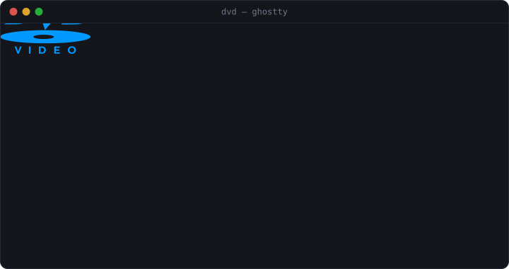

# dvd

<p align="center">
  
</p>

Classic bouncing **DVD Video** screensaver for the terminal—rendered as crisp vector graphics via the **Kitty Graphics Protocol** in **Ghostty**, **Kitty**, and **WezTerm** (including inside `tmux` with `allow-passthrough on`), with automatic fallback to sub-row TrueColor half-blocks (`▀`/`▄`) or ASCII everywhere else.

Zero external dependencies. Pure Go. Runs on macOS, Linux, BSD, and Windows.

## Install

```sh
go install github.com/oddurs/dvd@latest
```

Or grab a prebuilt archive from [Releases](https://github.com/oddurs/dvd/releases), or build from source:

```sh
git clone https://github.com/oddurs/dvd.git
cd dvd
go install .
```

## Usage

```sh
dvd                  # run at 240 FPS sub-pixel precision (auto-detects Kitty graphics)
dvd -x               # screensaver mode: exit on any key or mouse movement
dvd -stats           # show bounce counter & next-corner countdown
dvd -black           # force opaque pitch-black background
```

### Flags

```text
  -mode string   render mode: auto, kitty, ansi, or ascii (default "auto")
  -fps int       target frames per second, 15..360 (default 240)
  -speed float   movement speed multiplier (default 1.0)
  -scale float   logo width as fraction of screen width, 0.06..0.60 (default 0.21)
  -stats         show bottom status bar (bounces, corners, next corner ETA)
  -x, -screensaver
                 exit immediately on any keypress or mouse activity
  -black         force opaque pitch-black background instead of terminal default
  -no-video      omit 'VIDEO' label under the DVD disc
  -preview file  render a PNG preview sheet of the vector DVD logo and exit
  -v, -version   print version and exit
```

Respects [`NO_COLOR`](https://no-color.org/) and `tmux` DCS passthrough (`set -g allow-passthrough on`) automatically.

### Keys

| Key | Action |
| :--- | :--- |
| `q` / `Esc` / `Ctrl+C` | Quit |
| `s` / `?` | Toggle stats HUD & next-corner ETA |
| `c` | Subtly nudge angle to line up an upcoming corner hit |
| `r` | Randomize position, angle, and palette color |
| `+` / `-` (`Up` / `Down`) | Adjust bounce speed |
| `[` / `]` | Shrink / grow logo (live vector re-rasterization) |
| `n` | Cycle palette color |
| `m` | Cycle render mode (`kitty` → `ansi` → `ascii`) |
| `Ctrl+L` | Force full screen refresh |
| `Ctrl+Z` | Suspend to shell (resume with `fg`) |
| `Space` | Pause / resume |

## How It Works

At startup, `dvd` probes Kitty Graphics Protocol support and cell pixel dimensions (`TIOCGWINSZ` / Win32 console metrics, `CSI 16t`, `CSI 14t`), rasterizes the **DVD Video** SVG paths at 2× sub-pixel density via a 1D difference-array 8×8 supersampled active-edge rasterizer, encodes a single `FilterNone` 1-byte/px indexed PNG using a pooled `flate` + `adler32` stream, and patches only the 268-byte aligned Base64 `PLTE` + IEEE CRC32 window per palette color (`0 B/op`, `0 allocs/op` across live resizes). Each frame updates a constant `(c, r)` cell box via a half-pixel sliding source crop (`x, y, w, h`) inside synchronized output (`?2026h`) at 240 Hz with a drift-compensated phase-locked timestep pacer—yielding silky sub-pixel motion across 60–360 Hz displays with zero heap allocations on rendering, HUD formatting, or input parsing.

## License

[MIT](LICENSE)
